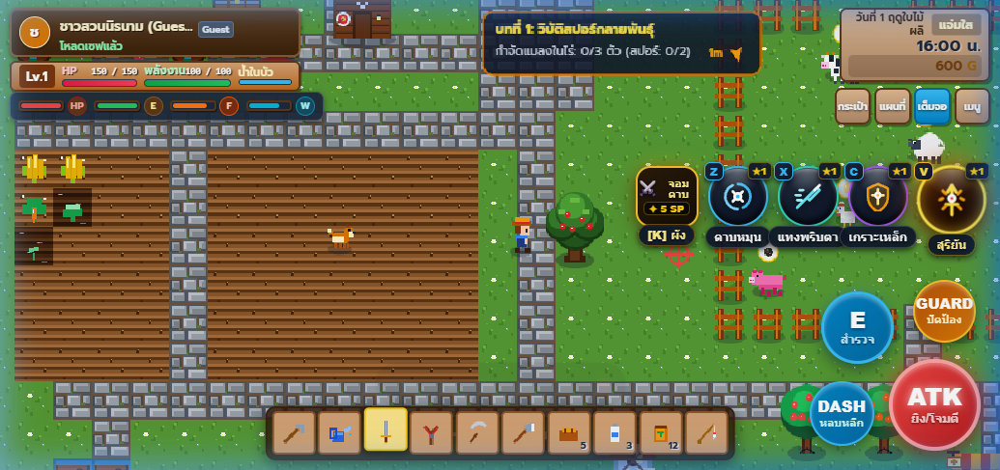
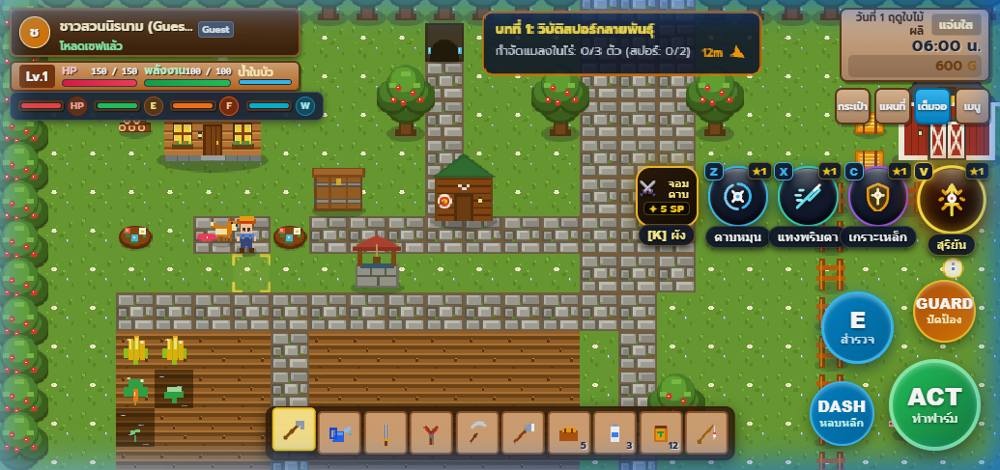

# 🌾 ฟาร์มสุขใจ (Happy Farm 2D)

เกมทำฟาร์ม 2D Pixel Art สไตล์ Cozy Retro ผสมผสานระบบต่อสู้ **Action RPG** และการควบคุมบนมือถือสไตล์ **MOBA (ROV Controls)** พัฒนาด้วย **TypeScript + HTML5 Canvas** โดยไม่พึ่งพา Game Engine ขนาดใหญ่

[](https://mratommic.github.io/gamefarm/)
[](https://www.typescriptlang.org/)
[](https://vitejs.dev/)

> 🎮 **เล่นเกมผ่านเบราว์เซอร์ได้ทันที:** [https://mratommic.github.io/gamefarm/](https://mratommic.github.io/gamefarm/)  
> (รองรับทั้งคอมพิวเตอร์และมือถือ จอสัมผัสแบบแนวนอน)

---

## 📸 ภาพตัวอย่างจากเกมจริง (In-Game Screenshots)

### ภาพรวมการทำฟาร์มและระบบควบคุมมือถือ

*แปลงผัก, คอกสัตว์เลี้ยง (วัว, แกะ, หมู), แถบปุ่มสัมผัสควบคุม และปุ่มลูกแก้วสกิลแฟนตาซี*

### แถบสกิลลูกแก้วรูน 3 มิติ และเควสต์เนื้อเรื่อง

*ลูกแก้วสกิลเฉพาะตัว 4 ช่อง [Z, X, C, V], ตราอัศวินผังสกิล [K] และเป้าหมายเควสต์กำจัดมอนสเตอร์*

---

## ✨ จุดเด่นของระบบเกม (Core Mechanics)

### 1. ระบบทำฟาร์มและปศุสัตว์ (Farming & Ranching)
- **แปลงปลูกพืชหมุนเวียนตามฤดูกาล:** ใช้จอบพรวนดิน รดน้ำ หว่านเมล็ดพืช (ข้าวสาลี, มะเขือเทศ, แครอท, ข้าวโพด, สตรอเบอร์รี่, ฟักทอง) และรอเก็บเกี่ยวผลผลิต
- **คอกสัตว์เลี้ยงแสนอบอุ่น:** เลี้ยงวัวนม (เก็บน้ำนมสด), แกะ (ตัดขนแกะ), ไก่ (เก็บไข่ไก่) และหมู (ขุดหาเห็ดทรัฟเฟิลดำ) พร้อมระบบลูบขน `[E]` เพื่อเพิ่มค่าความสุข
- **ร้านค้าเกษตรชุมชน:** ตั้งแผงขายผลผลิตหน้าร้าน มี NPC เดินมาเลือกซื้อสินค้า และรับเงินเหรียญทองเข้าระบบ

### 2. ระบบต่อสู้ Action RPG & 4 สายอาชีพ (Combat & Skill Tree)
สลับเล่นและอัปเกรดความสามารถได้ตลอดเวลาผ่านผังสกิล `[K]`:
- **⚔️ สายจอมดาบ (Blade Master):** คลื่นพายุคมดาบ 360 องศา, พุ่งทะลวงพริบตา, ปราการเกราะเหล็กสะท้อนดาเมจ และอัลติเมท *สุริยันพิฆาตสะบั้นหล้า*
- **🔮 สายจอมเวท (Elementalist):** บอลเพลิงโลกันตร์, วงแหวนเหมันต์แช่แข็ง, ม่านพายุปริซึมยิงเลเซอร์ และอัลติเมท *ฝนดาวตกกลืนนภา*
- **🏹 สายจอมพราน (Shadow Hunter):** ฝนธนูเจาะเกราะ, กับดักลวดหนามพิษ, ก้าวเงาล่องหนไร้เทียมทาน และอัลติเมท *ธนูอัสนีพิฆาตมังกร*
- **✨ สายอัศวินศักดิ์สิทธิ์ (Paladin):** หอกแสงพิพากษา, อวยพรเทวะฟื้นฟู HP/Energy, เสาเพลิงชำระล้าง และอัลติเมท *มหาทัณฑ์เทวาสะท้านภพ*
- **ระบบโจมตี 3-Hit Combo:** ฟันธรรมดาต่อเนื่อง 3 จังหวะพร้อมเสียงเอฟเฟกต์กระแทกคมชัด
- **ระบบปัดป้องการ์ด (Guard / Parry):** กดปุ่มบล็อกเพื่อลดความเสียหายและสะท้อนการโจมตี

### 3. ระบบควบคุมมือถือสไตล์ MOBA (Ergonomic Touch Controls)
- **Dynamic Floating Joystick:** อนาล็อกเคลื่อนที่ฝั่งซ้ายจะปรากฏขึ้นตรงจุดที่นิ้วแตะสัมผัส และจางหายไปเองเมื่อปล่อยมือ ไม่บังทัศนวิสัยในเกม
- **ROV Drag-to-Aim:** แตะค้างที่ปุ่มสกิลเพื่อลากเล็งทิศทางอย่างแม่นยำ พร้อมเส้นแสดงวิถีสกิลแบบเรียลไทม์
- **Drag-to-Cancel Zone:** หากไม่ต้องการปล่อยสกิล ให้ลากนิ้วไปยังปุ่มยกเลิก `✕` ด้านบน ระบบจะยกเลิกการร่ายโดยไม่เสียมานาหรือติดคูลดาวน์
- **Circular Runic Orbs:** ปุ่มสกิลทรงลูกแก้วกลม 3D พร้อมไอคอนเวกเตอร์ SVG ประจำสกิล และแถบชื่อสกิลแคปซูลด้านล่างที่อ่านง่าย ไม่ตัดข้อความตกบรรทัด

### 4. ระบบโปรไฟล์และบันทึกข้อมูล (Save & Multi-User)
- บันทึกสถานะผู้เล่น, ไอเทมในกระเป๋า, สิ่งก่อสร้าง, แปลงผัก และเควสต์ลง LocalStorage อัตโนมัติ
- รองรับการเข้าสู่ระบบผ่าน Google Sign-In เพื่อแยกโปรไฟล์ผู้เล่นอิสระ

---

## 🎮 การควบคุมในเกม (Game Controls)

### สำหรับเล่นบนคอมพิวเตอร์ (Keyboard & Mouse)

| ปุ่ม | คำสั่ง | รายละเอียด |
| :--- | :--- | :--- |
| **W, A, S, D** / **ลูกศร** | เคลื่อนที่ | ควบคุมทิศทางตัวละคร (มีระบบตรวจจับมุมเพื่อสไลด์ลื่นไหล) |
| **Spacebar** / **คลิกซ้าย** | โจมตี / ทำงาน | ใช้เครื่องมือทำฟาร์ม หรือฟันดาบโจมตีมอนสเตอร์ (3-Hit Combo) |
| **F** / **คลิกขวา** | ป้องกัน (Guard) | ยกการ์ดป้องกันและลดดาเมจจากการโจมตี |
| **Spacebar (ค้างขณะวิ่ง)** | กลิ้งหลบ (Dash) | พุ่งหลบหลีกการโจมตีอย่างรวดเร็ว |
| **E** | โต้ตอบ (Interact) | เปิดประตู, คุยกับ NPC, ลูบสัตว์, เปิดหีบสมบัติ |
| **Z, X, C, V** | เรียกใช้สกิล 1-4 | กดใช้สกิลต่อสู้ หรือลากเมาส์เพื่อเล็งทิศทาง |
| **K** | ผังสกิล (Skill Tree) | เปิดหน้าต่างเปลี่ยนสายอาชีพและอัปเลเวลสกิล |
| **1 - 9, 0** | ช่องลัด (Hotbar) | เลือกไอเทมหรือเครื่องมือบนแถบด้านล่าง |
| **Q** | สมุดเควสต์ | ตรวจสอบภารกิจประจำบทและเงื่อนไขการผ่าน |
| **Esc** | ปิดหน้าต่าง | ปิดหน้าต่างเมนูทั้งหมดที่เปิดอยู่ |

### สำหรับเล่นบนมือถือและแท็บเล็ต (Touch Screen)
- **หน้าจอฝั่งซ้าย:** แตะแล้วลากเพื่อเดินด้วย Dynamic Floating Joystick
- **หน้าจอฝั่งขวา:** ปุ่มลูกแก้วสกิล `[Z, X, C, V]`, ปุ่ม `ATK` (โจมตี/ทำฟาร์ม), `DASH` (กลิ้งหลบ), `E` (สำรวจ) และ `GUARD` (ยกการ์ด)

---

## 🛠️ โครงสร้างโปรเจกต์ (Project Structure)

```
gamefarm/
├── index.html              # โครงสร้างหน้าเว็บหลักและ HUD Overlays
├── style.css               # สไตล์ UI, Responsive Layout และเอฟเฟกต์แอนิเมชัน
├── src/
│   ├── main.ts             # Entry Point หลักสำหรับ Vite
│   ├── types/              # Type Definitions สำหรับ TypeScript
│   ├── data/
│   │   └── gamedata.ts     # ฐานข้อมูลไอเทม, แปลงพืช, อาหาร, มอนสเตอร์ และดรอปเรท
│   ├── audio/
│   │   └── soundEngine.ts  # ซินธิไซเซอร์เสียงเอฟเฟกต์ 16-bit Web Audio API
│   ├── sprites/
│   │   └── sprites.ts      # เรนเดอร์ภาพพิกเซลอาร์ตด้วย Procedural Canvas
│   ├── auth/
│   │   └── authManager.ts  # จัดการโปรไฟล์ผู้เล่นและระบบบันทึกเซฟ
│   └── engine/
│       └── game.ts         # Game Loop, ฟิสิกส์, สกิล และการคำนวณในเกม
└── docs/
    └── screenshots/        # ภาพประกอบจริงจากตัวเกม
```

---

## 🚀 การติดตั้งและรันในเครื่อง (Local Setup)

### ข้อกำหนดเบื้องต้น
- [Node.js](https://nodejs.org/) (เวอร์ชัน 18 ขึ้นไป)

### ขั้นตอนการรัน

```bash
# 1. ติดตั้ง Dependencies
npm install

# 2. เริ่มต้น Dev Server (เปิดที่ http://localhost:3000/)
npm run dev

# 3. ตรวจสอบโค้ดและ Build สำหรับ Production
npm run build

# 4. ทดสอบพรีวิวผลลัพธ์ของไฟล์ Build
npm run preview
```

### การ Deploy ขึ้น GitHub Pages

```bash
npm run deploy
```

---

## 📄 ลิขสิทธิ์และการพัฒนา (License & Credits)
โปรเจกต์นี้สร้างขึ้นเพื่อการศึกษาและการพัฒนาเกมด้วยเว็บเทคโนโลยีสมัยใหม่ โค้ดทั้งหมดเปิดให้เรียนรู้และต่อยอดได้อย่างอิสระภายใต้ [MIT License](LICENSE)
